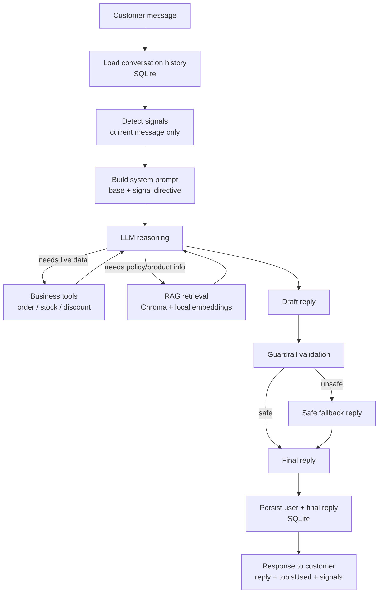

# Project 1 — Sales-Recovery Support Agent

A case study. Full technical documentation lives in [README.md](./README.md); this is the
condensed version — what problem it solves, how it's built, the decisions behind it, and what it
actually achieves, measured rather than claimed.

**Status: code complete; the real-model evaluation is still to be re-run.** It runs locally with one
command (see "Run it locally" in the README), on synthetic data and a credential-free demo provider.
There is no real store connected and no payment processing — see "Known limitations" below for the
full list of what this is not, and "Results" for exactly what has and has not been measured.

## Problem

Small international D2C stores lose sales in ways that are easy to overlook because each instance
looks minor: a shipping question that sits unanswered for a day, a return policy that's unclear
enough to make a customer hesitate, a customer who's clearly on the fence in a chat and gets a
generic reply instead of a helpful one. None of these are dramatic individually. Together, over
enough customers, they're a real, quantifiable source of lost revenue — and unlike a redesign or a
marketing campaign, they're addressable with a support experience that's simply faster and more
consistent than a small team can be by hand.

## Solution

An AI support agent that:
1. **Answers policy and product questions accurately**, grounded in the store's actual documented
   policies (shipping, returns, product care, FAQ) — not the model's general knowledge.
2. **Looks up real-time business data on request** — order status, stock, discount validity —
   through explicit tools, never by guessing.
3. **Remembers the conversation** within a session, so it doesn't ask the customer to repeat
   themselves.
4. **Notices a small set of sales-relevant signals** in what the customer says (hesitation, a
   shipping worry, a price concern) and responds a little more proactively when it sees one —
   without ever inventing a discount or promise to do it.
5. **Is constrained, not just prompted, to avoid the failure mode that matters most for a support
   bot**: stating something false about an order, a price, a policy, or making a promise (a refund)
   it has no way to actually fulfill.
6. **Is measured, not just demoed** — a versioned evaluation suite checks all of the above against
   21 representative cases, including injection and refusal attempts. It runs in a scripted mock
   mode today; a recorded run against a real model is still to be done.

## Architecture

**Modules** (`server/src/`), each independently testable and deliberately decoupled from the others:

| Module | Responsibility |
|---|---|
| `llm/` | Provider-agnostic `generateReply()`; Gemini and Anthropic adapters share one tool-calling loop |
| `tools/` | Three mock business tools (order status, stock, discount) — read-only, deterministic |
| `rag/` | Chunking, local embeddings, Chroma vector store, retrieval, and a `searchKnowledgeBase` tool |
| `memory/` | SQLite-backed conversation history, one repository interface |
| `signals/` | Deterministic, regex-based detection of 6 sales-relevant customer signal types |
| `guardrails/` | 8 explicit policies that validate (and can override) the model's reply before it's sent |
| `eval/` | Dataset schema, deterministic metrics, a runner that drives the real pipeline, an optional LLM judge |
| `routes/chat.js` | Wires all of the above into the one request flow shown above |

## Key engineering decisions

### Why RAG instead of putting store policy in the prompt
Stuffing every policy document into every request wastes tokens on content irrelevant to that
specific question, risks the model conflating similar-sounding policies (domestic vs. international
shipping), and means every content update requires touching code. Retrieval narrows to what's
actually relevant per question and lets policy content change by editing a markdown file, not the
prompt.

### Why Chroma
The brief locks RAG to Chroma or Qdrant. Both require a running server for their Node clients —
there's no pure-JS embedded mode for either. Docker is the usual way to self-host, but the real
question was what can be stood up locally with the least ceremony, for free. Chroma's Python
package ships a one-line local dev server (`chroma run`), which `npm run demo` starts for you; a
self-hosted Qdrant without Docker would have meant trusting an unsigned binary download. Qdrant
Cloud's free tier was set aside because this is a local-dev decision; production hosting is a
separate, later question (see `docs/HOSTING.md`). Tested with Chroma 1.5.9.

### Why SQLite for memory
Single small server process, low concurrency, zero infrastructure to provision, trivial to inspect
while debugging. A real production system with concurrent multi-tenant load would reach for
Postgres; that's not this system's constraint yet, and reaching for it now would be solving a
problem that doesn't exist.

### Why deterministic (regex-based) signal detection, not an LLM classifier
Free, instant, 100% reproducible, and every pattern is human-readable — no black box. The explicit
tradeoff: it only catches fairly direct English phrasing and will miss paraphrases or indirect
hints an LLM classifier would catch. That's an accepted limitation for this stage, not an oversight
— revisiting it would need evidence from real usage that it's actually missing signals that matter,
not a preemptive upgrade.

### Why guardrails are application code, not just a system prompt
A system prompt is a request the model can still get wrong. The guardrails (`guardrails/policies.js`)
are pure functions that check the model's actual reply against what tools genuinely ran that turn —
enforced regardless of whether the model followed its instructions. The honest caveat is that they
are regexes: they can block a good answer as well as a bad one. An earlier screenshot of a real
Gemini reply to "I'm still deciding" shows the fallback firing on a reply that probably did not
need it, and which policy fired was not recorded. Measuring that false-positive rate against a real
model is part of the remaining work.

## Evaluation methodology

A 21-case, versioned dataset (`server/eval/dataset.json`, v1.1.0) covering RAG, tool-calling,
signals, safety (including five injection and refusal attempts), memory, and mixed scenarios.
Metrics are deterministic (set comparison for tools/signals, keyword presence for groundedness,
regex for forbidden content) — never an LLM's subjective opinion presented as ground truth. An
optional LLM judge exists, clearly isolated and labeled subjective, off by default.

Two run modes: **mock** (each case replays its own scripted response: free, reproducible, and it
validates the harness and the code around the model, not the model) and **real** (the configured
provider, with tokens and latency recorded per case).

## Results

Measured directly, not estimated:

- **349** automated tests, all passing, offline (no key, no Chroma, no network).
- **21/21** evaluation cases pass in mock mode: tool selection 14/14, signal detection 16/16,
  grounded answers 11/11, unsupported answers 1/1, guardrail/safety 10/10, hallucination 0/18. A
  mock run replays scripted answers, so this is a regression check on the harness and the
  surrounding code. **It is not a measurement of a model.**

**Not measured yet:** any run against a real model. An earlier Gemini run was reported at 16/16 on
the original 16 cases, and it found a real grading bug (a typographic en dash in "7–12 business
days" failed a hyphen-only keyword check, now normalised and covered by a test), but the output of
that run was not kept, so no real-model figure is claimed here. `npm run eval:real` produces a
recorded one.

## Known limitations

Stated plainly, not glossed over:

- **No hosted instance.** It is run locally; `docs/HOSTING.md` describes how to host your own.
  Running it needs a local Chroma server, and a configured API key unless the credential-free `demo`
  provider is used.
- **All order/stock/discount/knowledge-base data is fictional**, hardcoded for demonstration — not
  connected to a real store, inventory system, or CRM. The UI states this explicitly.
- **No authentication, no payment processing, no real refund or human handoff** — the agent can
  discuss policy but has no tool that could issue a refund or connect a person, and anyone can look
  up any order number.
- **Signal detection is keyword/regex-based**, English-only, and will miss indirect phrasing.
- **Guardrails are pattern-based**, not a fact-checker — they confirm the right category of tool ran
  before a claim of that type is allowed through, not that every value in the reply is correct, and
  they can over-block.
- **The evaluation dataset is a 21-case smoke test**, not statistically powered coverage of real
  customer phrasing.
- **Model providers.** Gemini (free tier, `gemini-3.5-flash-lite`) is the default; the Claude
  Haiku 4.5 named in the original brief is implemented as the second provider and has **not yet been
  run** against the live API. A live model is not perfectly reproducible, so a future real-run
  result will describe that run.

## Future improvements

Gated by real need, not built speculatively:

- Record a real-model evaluation run, and measure the guardrails' false-positive rate with it.
- Run the Anthropic adapter once credits are available.
- Replace the mock business tools with a real store API (Shopify or similar), with authentication,
  once there is an actual store to connect to.
- Expand the evaluation dataset as real usage surfaces new cases worth locking in as regression
  tests.
- Consider upgrading signal detection beyond regex only if real conversations show it is missing
  signals that would have mattered.
