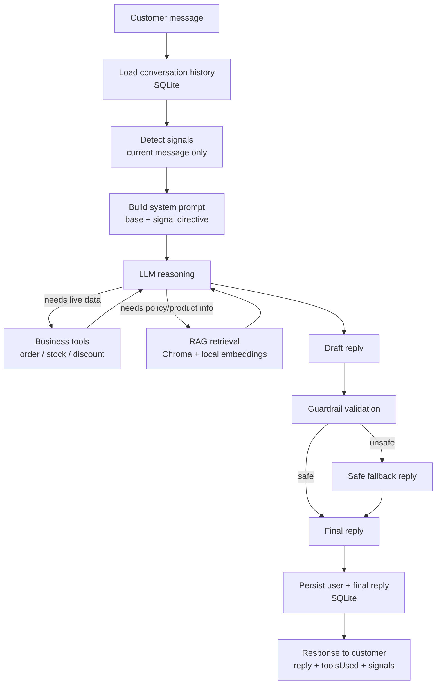

# Sales-Recovery Support Agent

A support chat agent for a fictional small online store. It answers policy questions from the
store's own documents (RAG), looks up order, stock and discount data through tools, remembers the
conversation, notices a few sales signals in what the customer writes, and is held to a set of
rules by code that runs after the model, not only by its prompt.

Node + Express, SQLite, Chroma, local embeddings. Gemini by default; Anthropic is implemented as a
second provider. All store data is invented. This is a portfolio project, not a product.

## Run it locally

**Prerequisites:**

- **Node.js 22.13 or newer** (the `engines` field in `server/package.json`; `node:sqlite` needs
  22.13 or later without a flag).
- **Chroma**, for the knowledge-base search: install it once with `pip install chromadb==1.5.9` and
  make sure the `chroma` command is on your `PATH` (on Windows that is pip's `Scripts` folder).

```
cd server && npm install && npm run demo
```

Then open <http://localhost:3000>. One terminal is enough: `npm run demo` starts a local Chroma
server if one isn't already running, ingests the knowledge base, and starts the app. Press Ctrl+C to
stop everything.

It runs on the fictional store's synthetic data with the deterministic `demo` provider, so **no API
key is needed**. The first run downloads a ~90 MB embedding model once, so it needs a network
connection that time.

<!-- DEMO_VIDEO: 60–90s screen recording of the app running locally goes here -->

## What has and hasn't been run

| | Status |
|---|---|
| Automated tests | **349 tests, all passing** (`cd server && npm test`). No API key, no Chroma and no network needed |
| Evaluation, mock mode | **21/21** (`npm run eval`). The mock replays each case's own scripted answer, so it checks the harness and the code around the model (guardrails, signals, memory, grading), **not a model** |
| Evaluation, real model | **To be re-run.** An earlier run on Gemini was reported but its output was not kept, so no result is claimed here. `npm run eval:real` produces a recorded one |
| Gemini adapter | Implemented and unit-tested against a fake client. The live call path has not been exercised since the adapter was hardened |
| Anthropic adapter | **Implemented, not yet run** against the live API |
| Hosted instance | None. See [docs/HOSTING.md](./docs/HOSTING.md) to host your own |
| Chroma | Tested with server 1.5.9 and the `chromadb` JS client 3.5.0 |

## How it works



The model makes three decisions: what to say, whether to call a tool, and what to say once a tool
has answered. Everything else (loading history, detecting signals, running the tool, validating the
draft, deciding what is saved) is ordinary code that runs whether or not the model behaved.

**Two kinds of knowledge, kept apart.** `searchKnowledgeBase` answers "what does our policy say?"
from four markdown documents in `server/data/kb/`. Three mock tools (`getOrderStatus`,
`checkStock`, `checkDiscount`) answer "what is true right now for this order, product or code?"
from a small hardcoded dataset standing in for a store API. All four are offered to the model as
ordinary tools through one loop, capped at three model calls per reply.

**Signals.** Six regex detectors (`purchase_intent`, `purchase_hesitation`, `shipping_concern`,
`price_concern`, `return_concern`, `cart_abandonment_risk`) look at the current message only. A
detected signal adds one short, non-prescriptive line to that turn's system prompt. It never
triggers an action outside the reply and never tells the model to offer a discount. Limitation:
direct English phrasing only.

**Guardrails.** Eight pure functions in `server/src/guardrails/policies.js` check the draft reply
against which tools actually ran this turn: no discount, stock, order-status or policy-timeframe
claim without the matching tool; no refund or compensation promise (no tool can fulfil one); no
disclosure of internals; no urgency language not backed by a stock check; no inference of a
sensitive personal attribute. A violation replaces the reply with a fixed, honest fallback, and the
fallback, not the blocked draft, is what gets saved. Limitation: they are patterns, and they check
that the right tool ran, not that the reply's numbers match its result.

**Memory.** SQLite through Node's built-in `node:sqlite`; the last 20 messages of the session are
sent with each request. Only the plain user message and the final reply are stored.

**Failure handling.** A model error, timeout or rate limit that outlasts the retries, and an empty
or blocked reply, all return a 502 with a plain message and persist nothing. A Chroma outage is
reported to the customer as "couldn't access that store information right now", never as "we have
no such policy", and an empty collection is re-ingested on demand.

## Providers

`LLM_PROVIDER` selects one; the routes never call an SDK directly.

| Value | What it is |
|---|---|
| `gemini` (default) | Google Gemini, `GEMINI_MODEL` (default `gemini-3.5-flash-lite`). Needs `GEMINI_API_KEY` |
| `anthropic` | Claude, `ANTHROPIC_MODEL` (default `claude-haiku-4-5-20251001`). Needs `ANTHROPIC_API_KEY`. Not yet run live |
| `demo` | A deterministic stand-in with no model and no key. It recognises a fixed set of support intents, calls the **real** tools and retrieval, and answers a policy question with the best-matching sentence(s) of the retrieved passages, word for word. Everything it says passes through the real guardrails. It deliberately emits one unsafe reply (a refund promise) so the guardrail can be seen working |

Both real providers run with a per-attempt timeout, bounded retries on a 429, a 5xx or a dropped
connection (waiting the server's `Retry-After` when it gives one; a wait over 15 s is not retried),
an explicit output-token cap and temperature, and token and latency recording per call.

## Configuration

Copy `server/.env.example` to `server/.env`. Every variable is optional with the `demo` provider.

| Variable | Default | |
|---|---|---|
| `LLM_PROVIDER` | `gemini` | `gemini`, `anthropic` or `demo` |
| `GEMINI_API_KEY`, `ANTHROPIC_API_KEY` | | Required by their provider |
| `GEMINI_MODEL`, `ANTHROPIC_MODEL` | see above | |
| `LLM_TIMEOUT_MS` | `30000` | Per attempt |
| `LLM_MAX_RETRIES` | `2` | Extra attempts |
| `LLM_MAX_OUTPUT_TOKENS` | `1024` | Includes a thinking model's reasoning tokens |
| `LLM_TEMPERATURE` | 1.0 Gemini, 0.2 Anthropic | |
| `PORT` | `3000` | |
| `SQLITE_PATH` | `server/data/memory.sqlite` | `:memory:` for a throwaway database |
| `CHROMA_HOST`, `CHROMA_PORT`, `CHROMA_SSL`, `CHROMA_COLLECTION` | `localhost`, `8000`, `false`, `sales_recovery_kb` | |
| `KB_DIR` | `server/data/kb` | |
| `RATE_LIMIT_MAX`, `RATE_LIMIT_WINDOW_MS` | `30`, `60000` | Per client IP, `POST /api/chat` only |
| `EVAL_DELAY_MS` | `8000` | Pause between cases and judge calls in `eval:real` |

`POST /api/chat` takes `{ sessionId, message }` (`sessionId`: 1-64 characters of letters, digits,
`-` or `_`; `message`: at most 2,000 characters) and returns `{ reply, toolsUsed, signals }`.
`GET /api/health` returns `{ "status": "ok" }`.

## Tests and evaluation

```
cd server
npm test                  # unit and integration tests, offline
npm run eval              # mock mode: free, deterministic, no key, no Chroma
npm run eval:real         # real model: needs the provider's key and a running Chroma
npm run eval:real:judge   # also asks the model to grade each reply (subjective, never scored)
```

`npm test` uses Node's built-in runner against an in-memory database, a fake vector store and fake
model clients (a fake clock for retries). The evaluation harness drives the real `handleChat`
through `server/eval/dataset.json` (version 1.1.0, 21 cases: RAG, tools, signals, safety including
five injection and refusal cases, memory, mixed). Every metric is a deterministic comparison: sets
for tools and signals, keywords for groundedness, regexes for forbidden content. Each real run
writes `server/eval-results/<timestamp>-<mode>.json` (gitignored) with per-case results and token
and latency totals.

Limitations of the evaluation, stated plainly: keyword groundedness is a proxy, not a fact-checker;
the forbidden-content regexes are a floor, not a ceiling; 21 cases is a smoke test, not coverage of
real customer phrasing.

## Structure

```
server/
  src/
    app.js, index.js     Express app and the process that listens
    config/              environment, read once
    routes/chat.js       handleChat(): the whole request flow
    llm/                 provider interface, tool loop, retry/usage helpers, providers/
    tools/               getOrderStatus, checkStock, checkDiscount (mock data)
    rag/                 chunker, ingest, local embeddings, Chroma wrapper, retrieval, the KB tool
    signals/             six regex detectors and their prompt directives
    guardrails/          eight policies and the fallback reply
    memory/              SQLite conversation store
    middleware/          rate limiter
    eval/                dataset schema, metrics, runner, optional judge
  data/kb/               the four knowledge-base documents
  eval/dataset.json      the versioned evaluation dataset
  scripts/               demo.js, ingest.js, eval.js
  test/                  the test suite
web/index.html           the demo chat page (no framework, no build step)
chroma/Dockerfile        a pinned Chroma image, only needed for hosting
docs/HOSTING.md          optional: host your own instance
PROJECT-1.md             the case-study write-up
```

## Known limitations

- Orders, stock, discounts and the knowledge base are fictional and hardcoded. There is no store
  integration, no authentication (anyone can look up any order number), no payment handling, and no
  way to actually issue a refund or hand over to a person: the fallback reply only *says* support
  can help.
- Signal detection and guardrails are regex patterns over English text.
- The `demo` provider is not a model. It understands a fixed set of questions and answers anything
  else with a fixed "choose one of the examples" reply.
- A free-tier model has request limits that this repo does not verify; see your provider's console.

See [PROJECT-1.md](./PROJECT-1.md) for the design decisions behind it and
[docs/HOSTING.md](./docs/HOSTING.md) to host your own copy.

## License

[MIT](./LICENSE)
