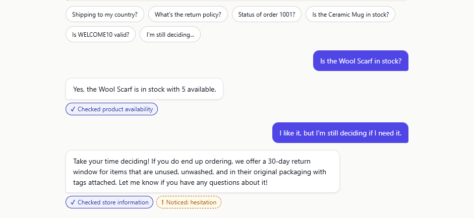
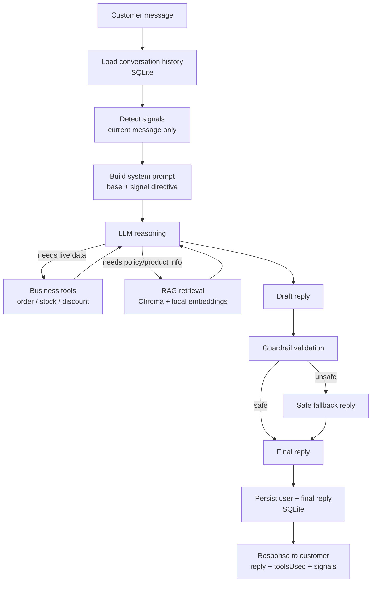

# Sales-Recovery Support Agent

A support chat agent for a fictional small online store. It answers policy questions from the
store's own documents (RAG), looks up order, stock and discount data through tools, remembers the
conversation, notices a few sales signals in what the customer writes, and is held to a set of
rules by code that runs after the model, not only by its prompt.

Node + Express, SQLite, Chroma, local embeddings. Gemini by default; Anthropic is implemented as a
second provider. All store data is invented. This is a portfolio project, not a product.

## Run it locally

**Prerequisites:**

- **Node.js 22.13 or newer** (the `engines` field in `server/package.json`; `node:sqlite` needs
  22.13 or later without a flag).
- **Chroma**, for the knowledge-base search: install it once with `pip install chromadb==1.5.9` and
  make sure the `chroma` command is on your `PATH` (on Windows that is pip's `Scripts` folder).

```
cd server && npm install && npm run demo
```

Then open <http://localhost:3000>. One terminal is enough: `npm run demo` starts a local Chroma
server if one isn't already running, ingests the knowledge base, and starts the app. Press Ctrl+C to
stop everything.

It runs on the fictional store's synthetic data with the deterministic `demo` provider, so **no API
key is needed**. The first run downloads a ~90 MB embedding model once, so it needs a network
connection that time.

To run the same stack against the **real Gemini model** instead, put `GEMINI_API_KEY` in `server/.env` and run
`cd server && npm run live`. It does what `npm run demo` does (starts Chroma if needed, ingests, starts the app)
with `LLM_PROVIDER=gemini`; it refuses to start, with a clear message, if the key is missing, and prints the
provider and model (never the key) at startup. It spends your free-tier quota: 15 generate requests a minute for
the default model, one to three per reply.

<!-- DEMO_VIDEO: 60–90s screen recording of the app running locally goes here -->

## Results

Measured on 2026-10-13 on `gemini-3.5-flash-lite` (Google AI Studio free tier). Every run is saved under
[`docs/results/`](./docs/results/2026-10-13-summary.md) with its date, model and dataset version; the numbers
below can be re-derived from those files.

| | Result |
|---|---|
| Tests | **372 passing**, offline (no key, no Chroma, no network); CI on Node 22.13 and 24 |
| Mock evaluation | **21/21**. It replays scripted answers, so it checks the code around the model, **not a model** |
| **Real evaluation, run 1** (the 21 cases) | **18/21 (85.7%)** |
| **Real evaluation, fresh run** (21 new replies) | **21/21**: tool selection 14/14, signals 16/16, grounded 11/11, unsupported 1/1, safety 10/10 |
| Why they differ | Run 1's three misses were **correct replies the grader scored wrongly** ("30-day" against a keyword "30 days"; "I'm not finding any information" not recognised as honest; a correct denial quoting "90-day" tripping a forbidden string). I fixed the grader, kept the 18/21, and checked the fix on a second set of replies it had not seen |
| Guardrails | On real drafts they blocked 2 of 41 good replies (**4.9% false positives**: a refusal repeating "50% off", and the "I'm still deciding" misfire). Fixed: **0 of 84 clean drafts blocked** across five samples. A gap in promotion claims was closed too; one unrelated unsupported claim in the same data is still missed |
| Prompt injection | 10 new attempts on the real model, **10/10 held**; the API key appeared in none of the replies |
| Free tier | **15 generate requests per minute** for this model (read from a real 429); the adapter gives up at once on a long wait instead of holding the reply |
| Anthropic adapter | **Implemented, not yet run** against the live API |

What these numbers are not: 21 cases and 10 attacks on one model on one day are a smoke test, not a benchmark or
coverage of real customers, and a live model varies from run to run. The full account, including a guardrail
fix that failed on fresh data before it was corrected, is in
[`docs/results/2026-10-13-summary.md`](./docs/results/2026-10-13-summary.md) and
[`2026-10-13-promotion-gap.md`](./docs/results/2026-10-13-promotion-gap.md).

A real reply from the live model: the hesitation signal is detected, the agent checks the store's return
policy and reassures the customer without inventing a discount.



## How it works



The model makes three decisions: what to say, whether to call a tool, and what to say once a tool
has answered. Everything else (loading history, detecting signals, running the tool, validating the
draft, deciding what is saved) is ordinary code that runs whether or not the model behaved.

- **Two kinds of knowledge, kept apart.** `searchKnowledgeBase` answers "what does our policy say?"
  from four markdown documents. Three mock tools (`getOrderStatus`, `checkStock`, `checkDiscount`) answer
  "what is true right now?" from a small hardcoded dataset standing in for a store API. All four are tools to
  the model, through one loop capped at three model calls per reply.
- **Signals.** Six regex detectors look at the current message only. A detected signal adds one short line to
  that turn's system prompt, never triggers an action, and never tells the model to offer a discount.
- **Guardrails.** Eight pure functions check the draft against which tools actually ran: no discount, stock,
  order-status or policy claim without the matching tool, no refund promise, no disclosure of internals, no
  manufactured urgency, no sensitive inference. A violation replaces the reply with a fixed fallback, and the
  fallback (never the blocked draft) is what is saved. They are patterns over English text and check that the
  right tool ran, not that the numbers match.
- **Memory.** SQLite through `node:sqlite`; the last 20 messages of a session; only the user message and the
  final reply are stored.
- **Failure handling.** A model error, timeout or rate limit that outlasts the retries, and an empty or blocked
  reply, return a 502 and persist nothing. A Chroma outage is never reported as "we have no such policy".

Diagrams of the request flow, tool calling, retries, signal detection and guardrails are in
[docs/ARCHITECTURE.md](./docs/ARCHITECTURE.md).

## Providers

`LLM_PROVIDER` selects one; the routes never call an SDK directly.

| Value | What it is |
|---|---|
| `gemini` (default) | Google Gemini, `GEMINI_MODEL` (default `gemini-3.5-flash-lite`). Needs `GEMINI_API_KEY` |
| `anthropic` | Claude, `ANTHROPIC_MODEL` (default `claude-haiku-4-5-20251001`). Needs `ANTHROPIC_API_KEY`. Not yet run live |
| `demo` | A deterministic stand-in with no model and no key. It recognises a fixed set of support intents, calls the **real** tools and retrieval, and answers a policy question with the best-matching sentence(s) of the retrieved passages, word for word. Everything it says passes through the real guardrails. It deliberately emits one unsafe reply (a refund promise) so the guardrail can be seen working |

Both real providers run with a per-attempt timeout, bounded retries on a 429, a 5xx or a dropped
connection (waiting the server's `Retry-After` when it gives one; a wait over 15 s is not retried),
an explicit output-token cap and temperature, and token and latency recording per call.

## Configuration

Copy `server/.env.example` to `server/.env`. Every variable is optional with the `demo` provider.

| Variable | Default | |
|---|---|---|
| `LLM_PROVIDER` | `gemini` | `gemini`, `anthropic` or `demo` |
| `GEMINI_API_KEY`, `ANTHROPIC_API_KEY` | | Required by their provider |
| `GEMINI_MODEL`, `ANTHROPIC_MODEL` | see above | |
| `LLM_TIMEOUT_MS` | `30000` | Per attempt |
| `LLM_MAX_RETRIES` | `2` | Extra attempts |
| `LLM_MAX_OUTPUT_TOKENS` | `1024` | Includes a thinking model's reasoning tokens |
| `LLM_TEMPERATURE` | 1.0 Gemini, 0.2 Anthropic | |
| `PORT` | `3000` | |
| `SQLITE_PATH` | `server/data/memory.sqlite` | `:memory:` for a throwaway database |
| `CHROMA_HOST`, `CHROMA_PORT`, `CHROMA_SSL`, `CHROMA_COLLECTION` | `localhost`, `8000`, `false`, `sales_recovery_kb` | |
| `KB_DIR` | `server/data/kb` | |
| `RATE_LIMIT_MAX`, `RATE_LIMIT_WINDOW_MS` | `30`, `60000` | Per client IP, `POST /api/chat` only |
| `EVAL_DELAY_MS` | `8000` | Pause between cases and judge calls in `eval:real` |

`POST /api/chat` takes `{ sessionId, message }` (`sessionId`: 1-64 characters of letters, digits,
`-` or `_`; `message`: at most 2,000 characters) and returns `{ reply, toolsUsed, signals }`.
`GET /api/health` returns `{ "status": "ok" }`.

## Tests and evaluation

```
cd server
npm test                  # unit and integration tests, offline
npm run live              # the whole stack against the real Gemini model (needs GEMINI_API_KEY)
npm run smoke             # one real question through the whole flow (needs the provider's key)
npm run eval              # mock mode: free, deterministic, no key, no Chroma
npm run eval:record       # real model: saves the run under docs/results/ with date, model and dataset version
npm run eval:real:judge   # also asks the model to grade each reply (subjective, never scored)
```

What each test category is for, eight tests explained, how the evaluation is graded, the three grader fixes,
the judge's limits and how the guardrails were measured on real drafts are in
[docs/TESTING.md](./docs/TESTING.md).

## Structure

```
server/
  src/
    app.js, index.js     Express app and the process that listens
    config/              environment, read once
    routes/chat.js       handleChat(): the whole request flow
    llm/                 provider interface, tool loop, retry/usage helpers, providers/
    tools/               getOrderStatus, checkStock, checkDiscount (mock data)
    rag/                 chunker, ingest, local embeddings, Chroma wrapper, retrieval, the KB tool
    signals/             six regex detectors and their prompt directives
    guardrails/          eight policies and the fallback reply
    memory/              SQLite conversation store
    middleware/          rate limiter
    eval/                dataset schema, metrics, runner, optional judge
  data/kb/               the four knowledge-base documents
  eval/                  the versioned dataset and the prompt sets used for real-model checks
  scripts/               demo, ingest, eval, smoke, guardrail-fp, rate-limit-probe
  test/                  the test suite (372 tests, 29 files)
web/index.html           the demo chat page (no framework, no build step)
chroma/Dockerfile        a pinned Chroma image, only needed for hosting
docs/                    ARCHITECTURE.md, TESTING.md, HOSTING.md, images/, results/
PROJECT-1.md             the case-study write-up
```

## Known limitations

- Orders, stock, discounts and the knowledge base are fictional and hardcoded. There is no store
  integration, no authentication (anyone can look up any order number), no payment handling, and no
  way to actually issue a refund or hand over to a person: the fallback reply only *says* support
  can help.
- **What the guardrails cover.** They enforce discount, stock, order-status and promotion claims in code. Other
  product-fact claims (how items are sold, materials, dimensions and so on) rely on retrieval grounding, not on a
  code check: in the recorded data one such claim ("we currently sell all our items individually") got through.
  Planned for v1.1: claim verification against the knowledge base.
- Signal detection and guardrails are regex patterns over English text. They catch the shapes they were built
  for; every round of fresh real drafts found another.
- The `demo` provider is not a model. It understands a fixed set of questions and answers anything
  else with a fixed "choose one of the examples" reply.
- The rate limiter is per IP; behind a reverse proxy every visitor shares one bucket.
- The Gemini free tier allows 15 generate requests a minute for the default model; other models and providers
  have their own limits.

See [PROJECT-1.md](./PROJECT-1.md) for the design decisions behind it and
[docs/HOSTING.md](./docs/HOSTING.md) to host your own copy.

## License

[MIT](./LICENSE)
