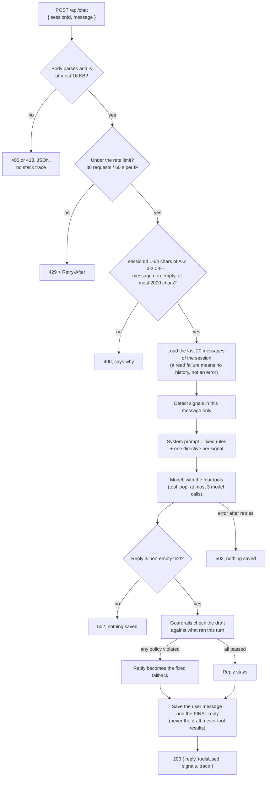
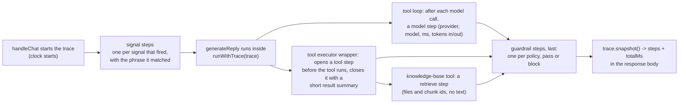
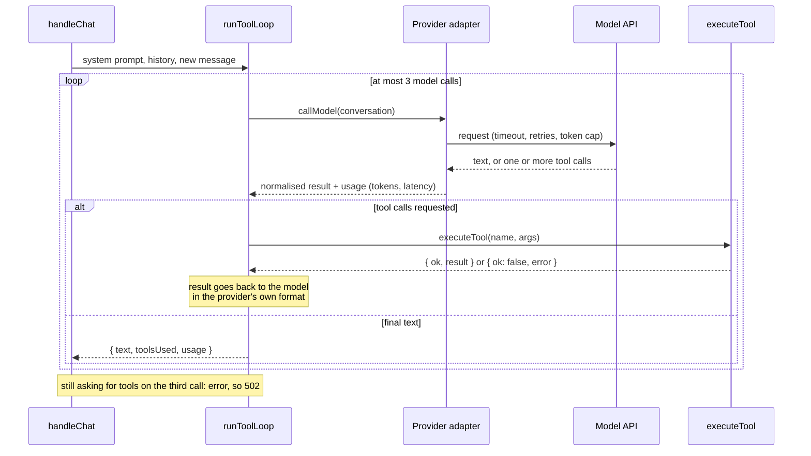
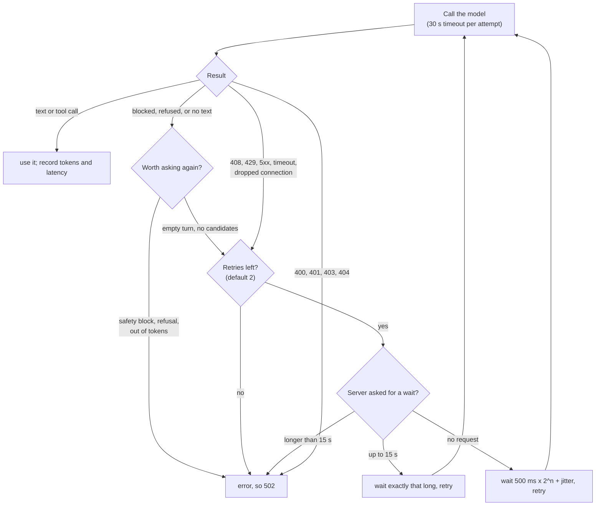
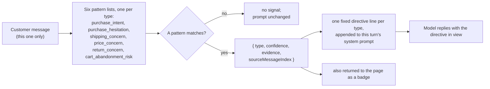
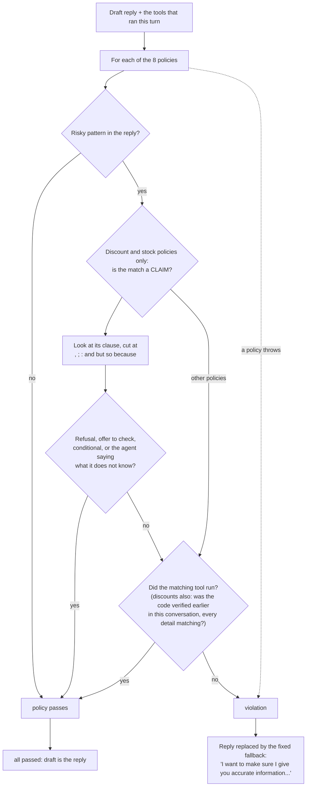

# Architecture

A support-chat agent for a fictional small online store. One HTTP endpoint, one function that runs
the whole turn (`handleChat`), and a small number of modules around it. This page explains how a
message is handled, why the pieces are separated the way they are, and where the limits are.

Paths are relative to `server/`. For what has been measured on a real model, see the
[README](../README.md#results) and [`docs/results/`](./results/2026-10-13-summary.md).

## The idea in one paragraph

The model is allowed to decide three things: what to say, whether to call a tool, and what to say once
a tool has answered. Everything else is ordinary code that runs whether or not the model behaved:
validating the request, loading history, detecting sales signals, running the tools, checking the
draft against eight rules, and deciding what is saved. A rule that matters is therefore enforced
after the model, in code, and not only requested in a prompt.

## Layout

```
src/
  app.js, index.js     Express app (body limit, error handler, rate limiter) and the process that listens
  config/env.js        every setting, read once
  routes/chat.js       handleChat(): the whole turn
  llm/                 provider-agnostic generateReply(), the tool loop, retry and usage helpers
    providers/         gemini.js, anthropic.js, demo.js (+ demoExtract.js)
  tools/               getOrderStatus, checkStock, checkDiscount: mock data, never-throwing dispatcher
  rag/                 chunker, ingest, local embeddings, Chroma wrapper, retriever, the searchKnowledgeBase tool
  signals/             six regex detectors and the one-line prompt directive for each
  guardrails/          eight policies and the fixed fallback reply
  trace/               the per-turn trace recorder (AsyncLocalStorage), the whitelist and the secret scrubber
  memory/              SQLite conversation store (node:sqlite)
  middleware/          in-memory rate limiter
  eval/                dataset schema, deterministic metrics, runner, optional judge
scripts/               demo, ingest, eval, smoke, guardrail-fp, rate-limit-probe
../web/                the chat page: index.html (markup), styles.css (themes, layout), app.js (the page),
                       trace.js (chips and the Operator panel), format.js (a reply as text nodes)
```

## 1. A request, start to finish



Three details carry most of the safety:

- **Guardrails run before the write.** A blocked claim is never saved, so a later turn cannot "remember"
  something the customer was never shown.
- **An empty or blocked model turn is a failure, not a reply.** It used to pass every guardrail (nothing
  to object to in an empty string) and be returned as a blank reply.
- **The response body is `{ reply, toolsUsed, signals, trace }`.** The guardrail verdict with the model's
  draft, and the raw tool results, are returned beside the body to the caller of `handleChat` (the
  evaluation and measurement scripts) and never to the browser. The trace (next section) is the one
  addition to what the browser receives, and it is built to be safe to show.

## 1b. The per-turn trace

The Operator view shows what the server did on a turn. That list is the `trace` in the response, and it is
**recorded while the turn runs, not reconstructed afterwards.**



Why recorded, not reconstructed. The alternative is to look at the finished reply and the list of tools that
ran and infer a story: "it mentioned a return policy, so it must have searched". An inferred trace can be wrong
in exactly the cases an operator opens it for, and a demo that shows steps that did not happen is worse than one
that shows none. Here each step is added by the code that did the work, at the moment it did it, so the order,
the timings and the contents are what really happened, and a step that did not run cannot appear. The rehearsal
script (`scripts/video-rehearsal.js`) also checks, on every real reply, that the trace agrees with the same turn's
`toolsUsed`, `signals`, usage record and guardrail verdict, which are produced by other code.

How it gets there without changing any provider: `handleChat` runs `generateReply` inside an
`AsyncLocalStorage` context holding the trace, and the three places that already see each event call
`currentTrace()?.…`: the tool loop (a model call), the tool executor wrapper in `llm/index.js` (a tool), and the
knowledge-base tool (a retrieval). Outside a turn there is no context and those calls do nothing, so unit tests of
a single module are unchanged. The demo provider makes no model call, and its step says so ("Demo assistant:
scripted replies, no model was called") rather than showing a model.

What a step may contain is decided by a whitelist in `src/trace/index.js`, not by "remember to leave things out":

| Step | Holds |
|---|---|
| `signal` | the signal type, its confidence, the phrase that matched (capped, one line) |
| `model` | provider, model id, latency in ms, tokens in and out as the adapter reported them (`null` when it did not) |
| `tool` | the tool name, its arguments (up to 8, each a plain string capped at 120 characters), whether it succeeded, a one-line summary, ms |
| `retrieve` | the query (capped), the source file names, and per chunk its id, heading and relevance. Never the text |
| `guardrail` | one per policy: its name and `pass` or `block`; a block adds the reason and rule. When a policy let a discount claim through because of a `checkDiscount` result, it also carries `verified: [{ code, basis, turn }]` and a `note`, for example "WELCOME10: verified by checkDiscount on turn 2 of this conversation". The matched phrase and the draft stay in the server log |

Every string that reaches a trace is cleaned: control characters and newlines removed, length capped, and the
value of any environment variable whose name contains KEY, TOKEN, SECRET, PASSWORD, AUTH or CREDENTIAL (and the
shape of a Gemini, OpenAI-style or Bearer credential) replaced with `[redacted]`, so even a customer who types a
key back, or an error message that contains one, cannot put it in the response. A failed tool shows its
controlled message ("getOrderStatus failed to execute."), never its stack. The trace never contains the system
prompt. A trace holds at most 64 steps.

Why a discount claim passed is recorded the same way, from the guardrail's own decision. The discount policy
reports what it relied on through a `note` callback it is given: either that `checkDiscount` ran on this turn, or
the codes its claim was matched against in the earlier-verification check (`checkAgainstVerified` returns them). The
turn numbers come from the conversation store: when a verification is saved it is stored with the turn it ran on
(the number of customer messages in the conversation at that point, in a `turn` column beside the tool result, never
inside it, so the result is still exactly what the tool returned; an older database file gets the column added and
its old rows read "earlier in this conversation"). The note is an explanation only: it is passed in after the
decision and cannot change it.

The guardrail outcome is `pass` or `block`. There is no "rewrite": when any policy objects, the whole reply is
replaced by the fixed fallback, so there is no partial edit to report.

On the page, `trace.js` turns the steps into rows (the eight guardrail steps are shown as one row so a clean turn
is a single "Guardrail: passed" line) and draws them, and the chips under an answer, with `createElement` and
text nodes only. A test asserts that no script in `web/` uses `innerHTML` or any other API that parses markup.
While a reply is pending the page shows one "Working…" line and, in the Operator panel, says the steps will
appear when the reply arrives: it cannot know the steps before the server has finished, and it does not guess.
Streaming them as they happen (server-sent events) is planned for v1.1.

## 2. Tool calling

Business data and policy text are two different kinds of knowledge and are offered to the model the
same way, as tools. The model chooses; the loop executes; the dispatcher never throws.



| Tool | Kind | Source |
|---|---|---|
| `getOrderStatus`, `checkStock`, `checkDiscount` | live data | mock tables in `src/tools/`, deterministic for a given clock day |
| `searchKnowledgeBase` | policy text | four markdown files, embedded locally, searched in Chroma |

- The tool dispatcher turns an unknown tool, bad arguments or an internal failure into
  `{ ok: false, error }` so one bad call cannot crash a turn. Order ids are looked up with
  `Object.hasOwn`, and stock names by whole word.
- The loop never touches a Gemini- or Anthropic-shaped object. Each adapter translates its own request
  and response format and hands the loop three callbacks. The model's own turn is echoed back verbatim
  (Gemini 3.x requires its `thought_signature` to survive that round trip).
- **Retrieval**: chunks of at most 800 characters split on `##` headings with a 100-character overlap,
  embedded with `Xenova/all-MiniLM-L6-v2` in-process, top 3 by cosine similarity, anything below 0.35
  dropped. "Nothing relevant found" and "the store could not be reached" are different results, so an
  outage is never reported as "we have no such policy". A Chroma handle that has gone stale is refreshed
  and the call retried once; an empty collection is re-ingested on demand (after a failed attempt, not again for a minute).

## 3. Model calls that go wrong



A customer waiting on a chat reply is better told "something went wrong, please try again" than held
for a minute, and a per-day quota will not clear by waiting. On the Gemini free tier the limit is 15
requests a minute (read from a real 429), which is why a rejected request is usually asking for about
50 seconds and the adapter gives up at once. The Anthropic SDK already retries with `Retry-After`, so it
gets its timeout and retry count passed in instead of being wrapped a second time.

## 4. Signal detection



- **Deterministic on purpose.** A hand-written regex is free, instant and reproducible, and a person can
  read every pattern and say why a signal did or did not fire. Confidence is a fixed number set by hand
  for each pattern (0.65 to 0.85), not learned. The limit is real: it catches direct English phrasing and
  misses paraphrase, sarcasm and other languages.
- **Current message only**, so a hesitation five turns ago cannot still be steering this reply.
- **A signal shapes tone and nothing else.** The directive for hesitation says to search the knowledge base for
  the return policy and state the window exactly as it gives it (never invent, round or estimate one, never
  describe returns in words the knowledge base does not use), and to *never invent or imply a discount*. The
  directive names no number itself, so the window can only come from the knowledge base. The first version said
  only "address likely concerns", and a real reply was once "hassle-free returns on eligible items" with no window. No directive tells the model to offer anything,
  and no signal triggers an email, a CRM update or any action outside the reply.
- Signals never reach the guardrails and the guardrails never reach the signals: separate modules, separate
  jobs.

## 5. Guardrails

Eight pure functions, each `({ reply, toolsUsed }) => reason | null`, in `src/guardrails/policies.js`.

| Policy | Blocks |
|---|---|
| `no_unverified_discount_claim` | a discount, code, percent-off, or a statement about promotions (that they exist, or that none do) when `checkDiscount` did not run |
| `no_unverified_stock_claim` | a stock or availability claim when `checkStock` did not run |
| `no_unverified_order_status_claim` | an order status or tracking detail when `getOrderStatus` did not run |
| `no_unverified_policy_claim` | a specific shipping, return or refund timeframe when `searchKnowledgeBase` did not run |
| `no_unsupported_refund_promise` | any promise of a refund or compensation, always (no tool can fulfil one) |
| `no_internal_disclosure` | the system prompt, keys, or code internals |
| `no_deceptive_urgency` | pressure or scarcity language not backed by a real stock check |
| `no_sensitive_personal_inference` | inferring a sensitive attribute about the customer |



- **Fail-safe**: if a policy function itself throws, that counts as a violation; a bug blocks, it never lets
  an unchecked reply through.
- **Claim versus mention.** On a real model, the first version of the discount and stock policies blocked
  good replies: a refusal that repeated "50% off", an offer to "check if something is in stock". They now
  count a match only if its clause is not a refusal, an offer, a conditional, or the agent saying it does not
  know. The clause is cut at commas and at *and / but / so / because*, so a refusal cannot excuse a claim in
  the next breath ("I can't promise it will last, but use SAVE20 for 20% off" is still blocked).
- **A code verified earlier in the same conversation.** The discount policy used to trust `checkDiscount` from the current turn only, so a true reply that named a code checked one turn before ("the only code I can verify is WELCOME10, which gives 10% off for first-time customers") was blocked. `chat.js` now keeps each successful `checkDiscount` result, exactly as the tool returned it, against its conversation (`verified_discounts`), and passes the earlier ones to the policy. A statement about such a code passes only if everything it claims matches that result: the code, any percentage, any date, an eligibility phrase that is in the tool's description, and whether it is valid. A money amount never matches (the tool returns percentages). A code never verified, a claim that names no code, any mismatch, and a code verified only in another conversation still block. The records come from the tool executor, never from model text or the customer's message.
- **Scope.** Guardrails enforce discount, stock, order-status and promotion claims in code. Other product-fact claims (how items are sold, materials, dimensions and so on) rely on retrieval grounding, not on a code check. Planned for v1.1: claim verification against the knowledge base.
- **What this does and does not prove.** The check is that the *right tool ran*, not that the reply's number
  matches the tool's. It is a set of patterns over English text: it catches the shapes it was built for, and
  every round of fresh real drafts has found another shape. That is why the model is also told the rules in
  the prompt, and why a claim of a given category needs a tool in the first place.

## 6. Provider abstraction

`generateReply({ systemPrompt, messages })` is the only call the route makes. `LLM_PROVIDER` picks the
implementation:

| Provider | What it is |
|---|---|
| `gemini` | Google Gemini via `@google/genai`. Default model `gemini-3.5-flash-lite`. Per-attempt `AbortSignal.timeout`, our own retry (the SDK has none unless asked), explicit `maxOutputTokens` and `temperature` (1.0, Google's recommendation for 3.x) |
| `anthropic` | Claude via `@anthropic-ai/sdk`. Model from `ANTHROPIC_MODEL`. **Implemented and unit-tested against a fake client; not yet run against the live API** |
| `demo` | No model. A fixed set of regex-recognised intents; it calls the **real** tools and retrieval and answers a policy question with the best-matching sentences of the retrieved passages, word for word. It deliberately emits one unsafe reply (a refund promise) so the real guardrail can be seen working |

Every real call records tokens, latency, attempts and finish reason. The tool loop sums them per reply,
`handleChat` logs one numbers-only line, and the evaluation records them per case.

## 7. Memory and persistence

SQLite through Node's built-in `node:sqlite`, two tables (`conversations`, `messages`), no native build.
The store keeps its database alive for its own lifetime (on Node 22 a database that only its prepared
statements referred to could be garbage-collected mid-use). Only the plain user message and the final reply
are stored. On a host without a persistent disk the file is ephemeral; that is a documented limit, not a bug.

## 8. The evaluation harness

`src/eval/` drives the real `handleChat` through `eval/dataset.json` (v1.2.0, 21 cases in seven
categories), so what is graded is the same function a request calls. Every metric is a deterministic
comparison, and the optional LLM judge is isolated and never scored. A case the model never answered is a
failed case with no checks (it used to be graded on the text "[HTTP 502]", which passes every
"must not contain" check). Details, and the grader fixes the first real run forced, are in
[TESTING.md](./TESTING.md).

## 9. Decisions and their costs

| Decision | Why | What it costs |
|---|---|---|
| Rules enforced in code after the model | A prompt is a request; code is a guarantee for the shapes it covers | Regexes over English text: they over-block and under-block, and need measuring on real drafts |
| Tools for live data, RAG for policy | A policy answer and a stock answer are different facts and must not be conflated | Two mechanisms to keep consistent |
| Signal detection by regex | Free, instant, readable, reproducible, can be tested | Direct phrasing only |
| One shared tool loop, capped at three model calls | A confused model cannot loop | A turn that needs more than two tool rounds fails |
| Fail fast on a long rate-limit wait | A customer should not be held for a minute | A busy free tier produces errors instead of slow answers |
| `node:sqlite` | No dependency, no build step | Needs Node 22.13 or later |
| Chroma behind a thin wrapper | Required by the brief; a self-healing handle for ephemeral hosts | A second process to run (`npm run demo` starts it) |
| Mock business tools | An honest stand-in for a store API | No authentication: anyone can look up any order number |
| A recorded trace, returned to every browser | The page can show only what really happened, with nothing animated or invented | The response is larger, and the trace is a second output that must be kept safe to show (whitelist, scrubbing, caps), which is tested |

## 10. Not built

No code check for product-fact claims beyond discount, stock, order status and promotions (v1.1: verify claims
against the knowledge base). No authentication, no real store or CRM, no payment handling, no human handoff (the fallback only says
support can help), no streaming of the steps (the page shows one "Working…" line until the reply arrives; SSE is planned for v1.1), no rate limiting per user (it is per IP, and behind a proxy all visitors
share one bucket), no multi-language support. Hosting your own copy is described in [HOSTING.md](./HOSTING.md).
